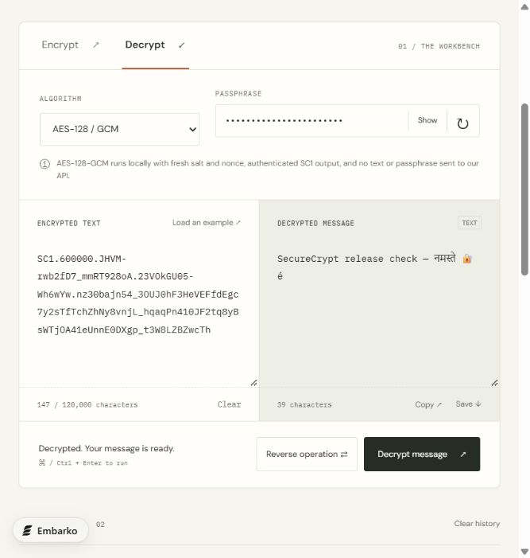

# SecureCrypt

**Understand encryption. Transform a message. Find your way back.**

[](https://github.com/VJ-veshwikjain2215/Secure-Crypt/actions/workflows/ci.yml)
[](pom.xml)
[](LICENSE)

[Live demo](https://veshwik-secure-crypt.embarko.app/) · [API & format](docs/API.md) · [Improvement reports](improvements/README.md) · [Contributing](CONTRIBUTING.md)

Explore modern and historical text transformations in a focused message/result workspace. SecureCrypt is an educational Java and Spring Boot project by Veshwik Jain.

<p align="center">
  
</p>

## Why this project

SecureCrypt pairs a usable encryption workspace with visible explanations of modern and historical ciphers. Its strongest engineering features are browser-local authenticated AES, an interoperable Java implementation, explicit legacy compatibility, and regression tests that preserve the lessons from the original audit.

| Area | Implementation |
| --- | --- |
| Interface | Native HTML, CSS, JavaScript; responsive light/dark workbench |
| Local cryptography | Web Crypto AES-GCM; legacy AES-CBC decryption |
| Backend | Java 21+, Spring Boot, JCA |
| Verification | JUnit, Node test runner, Java/browser interoperability, GitHub Actions |
| Hosting | Existing Java service on Embarko |

## The interface

- Encrypt/decrypt tabs, keyboard navigation, and Ctrl/Command + Enter to run.
- Default AES-GCM encryption and legacy AES decryption run locally with Web Crypto. Text and passphrases are not sent to the API in these modes; there is no server fallback.
- Classical and other legacy algorithms use the Java API; the interface identifies this before running.
- Local random-key generation, sample text, copy/download, and one-click reversal.
- Metadata-only session history, light/dark themes, responsive layouts, and algorithm explanations.

## Algorithms and compatibility

New AES messages use AES-128-GCM with a random 16-byte salt, random 12-byte nonce, a 128-bit authentication tag, and PBKDF2-HMAC-SHA256 at 600,000 iterations. A versioned `SC1` envelope carries parameters and authenticates the header. The Java AES API interoperates with browser outputs.

Old AES-CBC outputs require the explicit **Old AES-CBC · decrypt only** option (`AES_LEGACY` in the API). They cannot prove integrity. New encryption never falls back to CBC.

DES, Triple DES, Caesar, Vigenère, and repeating-key XOR remain educational comparisons. Caesar and Vigenère transform A–Z/a–z only and preserve other characters. Plaintext is limited to 20,000 JavaScript/Java UTF-16 code units; ciphertext input to 120,000, so encoded outputs can be decrypted. Keys are limited to 1,024 code units.

The [original audit](improvements/01-current-site-audit.md) preserves historical failures. The [follow-up report](improvements/05-correctness-and-crypto-update.md) identifies the fixes and remaining limitations. These regression checks are not an independent cryptographic review.

## Run locally

Install Java 21+ and Maven:

```sh
mvn spring-boot:run
```

Open `http://localhost:8080`. Web Crypto requires HTTPS or a browser's trusted localhost context. To package:

```sh
mvn package
java -jar target/SecureCrypt.jar
```

`PORT` overrides the server port.

## Verification

```sh
mvn verify
node --test tests/browser-crypto.test.mjs
```

Node 22+ is needed only for JavaScript tests. With the app running, `BASE_URL=http://localhost:8080 node tests/interop.mjs` checks browser/Java interoperability using synthetic data. In PowerShell, set `$env:BASE_URL='http://localhost:8080'` before `node tests/interop.mjs`.

GitHub Actions runs Java and browser-crypto tests and starts the packaged app for interoperability checks. Coverage includes Unicode boundaries, GCM tampering, wrong passwords, legacy compatibility, invalid API requests, and the shared API budget.

## API boundaries

API responses are non-cacheable. Password-strength lookup through URL parameters is retired (410); sample keys are generated locally by the UI. The optional key-generation API accepts lengths 8–128. Cross-origin API access is not enabled.

Each process admits at most two concurrent API requests and 120 requests per rolling minute across all callers. This is a small shared resource guard, not distributed or per-user abuse protection. Declared request bodies above 512,000 bytes are rejected; chunked bodies do not have a separate streaming byte cap. Field lengths are still validated.

## Structure

- `src/main/java/` — REST API, cipher services, validation, and request guards.
- `src/main/resources/static/` — HTML/CSS/JavaScript and Web Crypto module.
- `src/test/`, `tests/` — Java, browser-crypto, and interoperability regressions.
- `improvements/` — historical audit, comparison, roadmap, redesign, and fix reports.
- `docs/` — original academic documentation, which predates these changes.
- `embarko.json` — existing app identity; remove before deploying a fork.
- `railpack.json` — Java provider. The small `package.json` is a hosting-validator compatibility descriptor, not a Node application.

The frontend uses native HTML/CSS/JavaScript and Google Fonts. Java APIs use Spring Boot and JCA. Browser-local processing does not protect against a compromised device or altered application code; legacy ciphers remain unsuitable for new secret protection.

## Project history and next steps

Read the [changelog](CHANGELOG.md) for shipped milestones, the [improvement plan](improvements/03-improvement-plan.md) for proposals, and the [latest implementation report](improvements/05-correctness-and-crypto-update.md) for completed fixes. Proposed capabilities such as file encryption and offline installation are not currently shipped.

## Contribute

Start with [contribution guidance](CONTRIBUTING.md), [report a bug](https://github.com/VJ-veshwikjain2215/Secure-Crypt/issues/new?template=bug_report.yml), or [suggest a feature](https://github.com/VJ-veshwikjain2215/Secure-Crypt/issues/new?template=feature_request.yml). Please use synthetic data. Report vulnerabilities privately through the [security policy](SECURITY.md), and follow the [code of conduct](CODE_OF_CONDUCT.md).

If this project helps you learn or build something, a star helps others discover it.

## License and author

Source code is available under the [MIT license](LICENSE). Personal branding, personal documents, and third-party assets retain their respective rights and are not granted separate reuse permission by this notice. Dependencies retain their own licenses.

Built by [Veshwik Jain](https://veshwik-jain-portfolio.embarko.app/) · [GitHub](https://github.com/VJ-veshwikjain2215)
