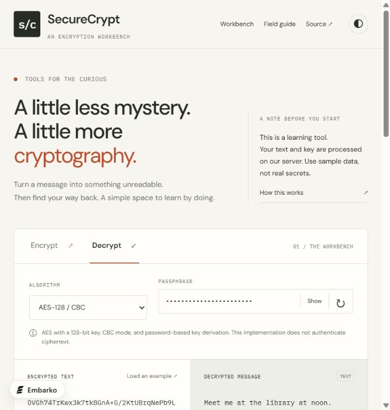

# 4. SecureCrypt redesign update report

**Date:** 29 October 2026 (Asia/Kolkata)

**Live release:** [SecureCrypt workbench](https://veshwik-secure-crypt.embarko.app/?release=workbench-1)

**Implementation:** [Redesign pull request #2](https://github.com/VJ-veshwikjain2215/Secure-Crypt/pull/2), merged as [`4a99366`](https://github.com/VJ-veshwikjain2215/Secure-Crypt/commit/4a993664c59a4f7592f7cd6f931e01dad35e3306).

## Purpose

Replace the previous promotional, gradient-heavy page with a focused tool that makes text encryption easier to understand and use. The redesign prioritizes the operation itself, clear input/output relationships, restrained presentation, and accurate explanations of the application's trust boundary.

This report describes the shipped interface update. It is not a claim that all findings in the original audit have been resolved.

## Before and after

| Area                          | Previous interface                                                                    | Shipped workbench                                                                                              |
| ----------------------------- | ------------------------------------------------------------------------------------- | -------------------------------------------------------------------------------------------------------------- |
| Visual style                  | Blue gradients, decorative statistics, icon-heavy cards, and a large promotional hero | Warm neutral surfaces, charcoal text, a restrained rust accent, thin borders, and a compact introduction       |
| Branding                      | Generic shield imagery                                                                | Custom s/c mark, matching favicon, and a typographic wordmark                                                  |
| Workspace                     | Separate encryption and decryption cards with duplicate controls                      | One workspace with Encrypt/Decrypt tabs, shared configuration, and adjacent input/result panels                |
| Starting an experiment        | Manual input and key entry                                                            | Algorithm-aware sample loader and locally generated random sample keys                                         |
| Returning to plaintext        | Manual copying between cards                                                          | Reverse operation transfers the last successful result and algorithm while retaining the current key in memory |
| Passphrase presentation       | Plain-text inputs by default                                                          | Masked inputs with an explicit Show/Hide control                                                               |
| Password-strength interaction | Password sent in a GET query for a heuristic rating                                   | Strength-meter calls removed from this UI; no replacement strength claim is made                               |
| History                       | Message/ciphertext previews                                                           | Operation, algorithm, input length, and time only; up to 20 visible entries                                    |
| Learning content              | Repeated algorithm cards and broad industry-standard language                         | Expandable field guide distinguishing modern, classical, educational, and legacy uses                          |
| Privacy messaging             | Absolute client-privacy and storage claims                                            | Clear disclosure that the server receives text and keys; sample-data guidance and a link to the audit          |
| Frontend dependencies         | Bootstrap CSS/JavaScript and icon fonts                                               | Native HTML, CSS, JavaScript, a small SVG favicon, and Google Fonts                                            |

## Visual system

The default theme uses an off-white page, slightly differentiated input/output surfaces, dark text, and one muted accent color. DM Sans handles the interface and IBM Plex Mono distinguishes technical labels, counters, and message text. The dark theme uses the same hierarchy rather than a separate visual style.

The page is organized as introduction → workbench → session activity → algorithm field guide → project/privacy explanation. Responsive rules stack the editors on phone widths and simplify navigation. Reduced-motion preferences disable smooth scrolling and transitions.

The page no longer uses decorative algorithm/privacy statistics as its central pitch. Necessary details sit beside the controls they explain.

## Interaction changes

### Operation flow

1. Choose Encrypt or Decrypt.
2. Select an algorithm and enter a sample key/passphrase.
3. Write text or load an example.
4. Run the operation with the primary button or Ctrl/Command + Enter.
5. Inspect the result, copy it, save a text file, or transfer it into the opposite operation.

The reverse action copies the result and algorithm, not a newly generated key. The user must retain the same key for a successful round trip. It does not automatically submit the next operation.

### Feedback and validation

The interface provides a live status region, loading/disabled states, empty-input checks, basic Caesar/Vigenère key checks, and a 30-second request timeout. Dynamic messages are rendered with textContent rather than injected HTML. Server errors remain subject to the backend's existing response behavior.

The redesigned UI rejects inputs beyond the current 20,000-character API limit instead of claiming unlimited support. This does not solve the audited backend mismatch where valid encryption output can expand beyond that limit.

### Key handling and history

Random sample keys are generated locally with crypto.getRandomValues. They are sent to the server only when an encryption/decryption operation runs. The new interface does not call the old key-strength endpoint.

History exists in page memory and contains metadata, not text or key previews. Its clear control removes the visible session list. It is not a promise that active form values, clipboard contents, downloads, or server/provider diagnostics have been erased.

Theme choice is stored in sessionStorage when available. Theme changes still work if storage access is unavailable.

## Accessibility improvements

- Skip link to the workbench.
- Explicit labels associated with input, key, algorithm, and output controls.
- Named theme, key-reveal, and key-generation controls.
- Operation tabs expose selection state and support arrow keys, Home, and End.
- Visible keyboard focus and a polite status region.
- Masked secret fields and explicit reveal state.
- Responsive layout and reduced-motion handling.

These are implemented improvements, not a WCAG certification. A full screen-reader, contrast, zoom, and cross-browser audit remains outstanding.

## Validation performed

| Check                          | Outcome and limit                                                                           |
| ------------------------------ | ------------------------------------------------------------------------------------------- |
| JavaScript syntax              | Node syntax check passed                                                                    |
| Java packaging                 | Maven package completed successfully; the repository still has no automated Java test cases |
| Local browser AES flow         | Load example → encrypt → reverse transfer → decrypt returned the original message           |
| Live browser AES flow          | The deployed release returned `Meet me at the library at noon.` after the same round trip   |
| Phone layout                   | Inspected at 390 × 844; editors stacked and controls remained available                     |
| Deployment                     | Existing claimed Embarko app updated successfully; no new subdomain created                 |
| Source/deployment traceability | Changes merged to GitHub; successful deployment record linked to the implementation commit  |

Clipboard completion, file-download completion, every algorithm in the redesigned UI, full keyboard traversal, and all browser/device combinations were not independently verified in this update. The original API audit is a historical baseline, not a fresh passing suite for this release.

## Files changed

- `src/main/resources/static/index.html` — complete page composition and semantic controls.
- `src/main/resources/static/css/style.css` — responsive visual system, themes, focus and motion styles.
- `src/main/resources/static/js/script.js` — workbench state, request flow, local key generation, metadata-only history, and output actions.
- `src/main/resources/static/favicon.svg` — custom brand icon.
- `README.md` — documentation aligned with the new interface and known limitations.
- `src/main/resources/application.properties`, `embarko.json`, `package.json`, and `railpack.json` — existing deployment settings committed for reproducibility. The package descriptor is a validator compatibility file; the app still builds/runs as Java.

## Remaining work from the audit

| Audit area                                       | Status after redesign                                                 |
| ------------------------------------------------ | --------------------------------------------------------------------- |
| Passwords in strength-check URLs                 | Removed from the new UI; the old public endpoint still exists         |
| Plain-text default key fields                    | Masked in the new UI                                                  |
| Dynamic toast HTML sink                          | Old toast implementation removed; new feedback uses textContent       |
| Misleading absolute privacy wording              | Replaced with server-processing disclosure                            |
| Missing control labels                           | Improved in the new markup; broader accessibility review still needed |
| Unauthenticated AES/CBC ciphertext               | Unchanged; authenticated-format migration remains necessary           |
| Fixed KDF salt/work factor                       | Unchanged                                                             |
| Unicode corruption in Caesar/Vigenère            | Unchanged; limitations are disclosed                                  |
| Expanded-ciphertext size mismatch                | Unchanged in backend; the UI reports its current limit                |
| Malformed-request 500 responses                  | Unchanged                                                             |
| Generator bounds, rate limits, headers, and CORS | Backend follow-up remains                                             |
| Automated regression suite                       | Still needed                                                          |

## Recommended next step

Implement the correctness and cryptographic work in the [prioritized improvement plan](03-improvement-plan.md), beginning with data reversibility and input/error contracts, then the versioned authenticated-encryption format. Keep the simplified interface stable while those behaviors change underneath it.
